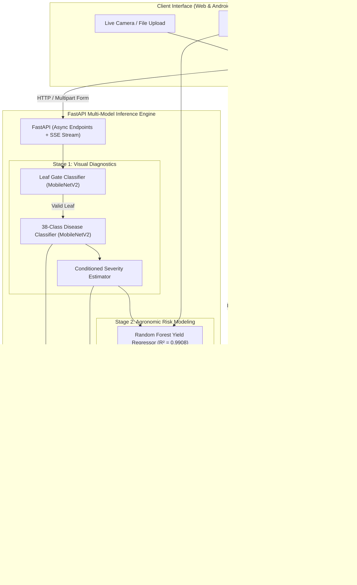

<div align="center">

# 🌿 CropLens AI
### Multimodal Agricultural Diagnostic Intelligence & Yield-Risk Decision Support System

[](https://react.dev/)
[](https://vitejs.dev/)
[](https://fastapi.tiangolo.com/)
[](https://pytorch.org/)
[](https://capacitorjs.com/)
[](https://ai.google.dev/)
[](https://docs.pytest.org/)

<p align="center">
  <b>A unified precision agriculture platform combining computer vision, environmental soil/weather context, Random Forest yield modeling, risk fusion mathematics, and Gemini-powered agronomic advisory — accessible via Web & native Android mobile APK.</b>
</p>

[Key Features](#-key-features) •
[System Architecture](#-system-architecture) •
[Model Performance](#-model-benchmarks--performance) •
[Quickstart Guide](#-quickstart-guide) •
[Android Mobile App](#-android-mobile-app) •
[Research & IEEE Paper](#-research--ieee-documentation)

---

</div>

## 🌟 Overview

Modern agricultural disease diagnosis is frequently isolated from actionable agronomic decision-making. Standard tools often predict a single disease label in a vacuum without considering:
1. **Whether the uploaded image is actually a valid leaf** (preventing out-of-distribution false positives).
2. **Visual disease severity grade** (mild vs. moderate vs. severe infection).
3. **Soil, weather, and farm environmental factors** (NPK, pH, temperature, precipitation).
4. **Quantified harvest yield impact** (expected loss in metric tons per hectare).
5. **Grounded, disease-specific biological guidance** (causative pathogen, spread vectors, chemical safety disclaimers).

**CropLens AI** resolves this disconnect by integrating a multi-stage machine learning pipeline with real-time SSE streaming, interactive 3D visualizations, and an Android APK featuring live camera image capture for field farmers.

---

## 🚀 Key Features

- **🍃 38-Class Plant Disease Identification**: Detects 38 distinct crop-disease conditions across 14 major agricultural crops with **97.09% validation accuracy**.
- **🛡️ Out-of-Distribution Leaf Gating**: Validates whether the image contains an agricultural leaf before running classification, rejecting random objects or non-leaf photos.
- **🔬 Conditioned Severity Assessment**: Quantifies infection severity (Early, Moderate, Severe) with **95.57% held-out Macro-F1**.
- **📈 Multi-Factor Yield Risk Modeling**: Random Forest yield regression ($R^2 = 0.9908$) evaluates environmental parameters (Nitrogen, Phosphorus, Potassium, Rainfall, Soil pH) to estimate yield loss under disease pressure.
- **⚡ Real-Time SSE Inference Pipeline**: End-to-end multi-model inference completes in **21–60 ms** on CPU with live Server-Sent Events (SSE) streaming progress to the client.
- **🧠 Grounded Gemini Agricultural Engine**: Integrates an agricultural knowledge base with Google Gemini Flash to generate pathogen biology, transmission mechanics, organic & chemical interventions, and precautionary advice.
- **📱 Native Android Mobile App**: Packaged via Capacitor with direct device camera integration (`capture="environment"`), responsive mobile touch layout, and cleartext API connectivity.
- **🌐 3D Interactive Web Experience**: Interactive Three.js/React Three Fiber 3D scene, Framer Motion transitions, GSAP smooth scroll, and bilingual voice-text assistance.

---

## 🏗️ System Architecture



---

## 📊 Model Benchmarks & Performance

All models were evaluated on independent held-out test splits:

| Component | Model Architecture | Metric | Result |
| :--- | :--- | :--- | :--- |
| **Disease Classifier** | Fine-Tuned MobileNetV2 | Top-1 Validation Accuracy | **97.09%** |
| **Severity Estimator** | Conditioned MobileNetV2 | Held-Out Macro-F1 | **95.57%** |
| **Yield Regressor** | Optimized Random Forest | Coefficient of Determination ($R^2$) | **0.9908** |
| **Yield Regressor** | Optimized Random Forest | Mean Absolute Error (MAE) | **0.1229 t/ha** |
| **End-to-End Pipeline** | Full Sequential Pass (CPU) | Average Inference Latency | **21 – 60 ms** |
| **Automated Verification** | PyTest Backend Suite | Regression Test Coverage | **84 / 84 Passed (100%)** |

---

## 🌾 Supported Crops & Diseases (38 Classes)

CropLens AI covers **14 agricultural crops** across **38 pathological and healthy conditions**:

<details>
<summary><b>Click to expand the full list of 38 supported classes</b></summary>

- **Apple**: Scab, Black Rot, Cedar Apple Rust, Healthy
- **Blueberry**: Healthy
- **Cherry**: Powdery Mildew, Healthy
- **Corn (Maize)**: Cercospora Leaf Spot (Gray Leaf Spot), Common Rust, Northern Leaf Blight, Healthy
- **Grape**: Black Rot, Esca (Black Measles), Leaf Blight (Isariopsis), Healthy
- **Orange**: Citrus Greening (Huanglongbing)
- **Peach**: Bacterial Spot, Healthy
- **Pepper (Bell)**: Bacterial Spot, Healthy
- **Potato**: Early Blight, Late Blight, Healthy
- **Raspberry**: Healthy
- **Soybean**: Healthy
- **Squash**: Powdery Mildew
- **Strawberry**: Leaf Scorch, Healthy
- **Tomato**: Bacterial Spot, Early Blight, Late Blight, Leaf Mold, Septoria Leaf Spot, Spider Mites (Two-spotted spider mite), Target Spot, Yellow Leaf Curl Virus, Mosaic Virus, Healthy

</details>

---

## 📂 Project Directory Structure

```text
CropLens-AI/
├── android/                         # Capacitor native Android Gradle project
│   ├── app/                         # Android application manifest, source & assets
│   └── build.gradle                 # Native build settings & permissions
├── ieee ref/                        # Full IEEE Academic Project Report & Documentation
│   ├── CropLens Documentation/      # Complete 7-chapter LaTeX source files & figures
│   ├── CropLens_AI_IDP_3.pptx       # Presentation slide deck
│   └── CropLens_AI_Project_Overview.docx # Technical overview document
├── ml-service/                      # FastAPI Python Machine Learning Microservice
│   ├── models/                      # Serialized PyTorch (.pth) & Scikit-learn (.pkl) models
│   ├── training/                    # Model training scripts and pipelines
│   ├── tests/                       # 84 automated pytest test suites
│   ├── gemini_service.py            # Google Gemini Flash explanation engine
│   ├── knowledge_base.py            # Verified agronomic knowledge dictionary (38 classes)
│   ├── risk_fusion.py               # Quantitative multi-factor risk fusion mathematics
│   ├── main.py                      # FastAPI application, CORS & streaming endpoints
│   └── requirements.txt             # Python backend dependencies
├── public/                          # Static web assets & textures
├── src/                             # React 19 Frontend Application
│   ├── components/                  # Reusable UI, 3D Canvas, and Assistant components
│   ├── config/                      # API endpoint configurations
│   ├── data/                        # Academic research references & sample data
│   ├── services/                    # Client services (AI Assistant, Speech-to-Text)
│   ├── views/                       # Core screens (Landing, Scan, Processing, Report)
│   ├── App.jsx                      # Main app orchestrator
│   └── index.css / App.css          # Design system & responsive styles
├── capacitor.config.json            # Capacitor mobile configuration
├── package.json                     # Node.js dependencies & scripts
└── vite.config.js                   # Vite bundler configuration
```

---

## ⚡ Quickstart Guide

### 1. Prerequisites
- **Node.js**: v18.x or later (`node -v`)
- **Python**: v3.10 or v3.11 (`python --version`)
- **Git**

---

### 2. Backend Setup (FastAPI & ML Service)

```bash
# Navigate to the ML service directory
cd ml-service

# Create and activate a virtual environment
python -m venv venv
# Windows:
venv\Scripts\activate
# Linux/macOS:
source venv/bin/activate

# Install required dependencies
pip install -r requirements.txt

# (Optional) Set your Gemini API key for AI agronomic explanations
# Create a .env file inside ml-service/:
# GEMINI_API_KEY="your-gemini-api-key-here"

# Start the FastAPI backend server
uvicorn main:app --host 0.0.0.0 --port 8000 --reload
```
The backend API is now live at `http://localhost:8000`. You can test endpoints via the interactive Swagger documentation at `http://localhost:8000/docs`.

---

### 3. Frontend Setup (React 19 + Vite)

Open a new terminal window at the project root:

```bash
# Install NPM dependencies
npm install

# Start the Vite local development server
npm run dev
```
Open your browser at `http://localhost:5173` to explore the live application.

---

### 4. Running the Test Suite

CropLens AI includes **84 automated backend tests** covering class alignment, knowledge base schema validity, severity mapping, risk fusion formulas, and Gemini fallback robustness:

```bash
cd ml-service
pytest tests/ -v
```
All **84 tests pass in ~6 seconds**.

---

## 📱 Android Mobile App

CropLens AI has a fully integrated native Android platform powered by Capacitor.

### Building the APK
1. Build the web assets:
   ```bash
   npm run build
   ```
2. Sync assets with the Android native project:
   ```bash
   npx cap sync
   ```
3. Compile the standalone debug APK:
   ```bash
   cd android
   ./gradlew assembleDebug
   ```
4. Output APK location:
   ```text
   android/app/build/outputs/apk/debug/app-debug.apk
   ```

### Real-Time Camera Feature
The mobile APK features direct camera hardware binding:
- **Take Photo**: Launches device camera via `capture="environment"` for immediate leaf photography.
- **Browse Files**: Selects images from internal device storage or gallery.
- **Permissions Configured**: `CAMERA`, `READ_EXTERNAL_STORAGE`, `READ_MEDIA_IMAGES`, and cleartext HTTP traffic configured in `AndroidManifest.xml`.

---

## 📄 Research & IEEE Documentation

The repository includes complete academic project documentation inside the [`ieee ref/`](file:///c:/3D-WEBSITE-TEMPLATE%20(1)/ieee%20ref/) directory:
- **7-Chapter LaTeX Source**: Formatted to IEEE field project report specifications with verified references, equations, and tables.
- **Presentation Deck**: Pre-configured defense slide deck (`CropLens_AI_IDP_3.pptx`).
- **Comprehensive Project Overview**: Detailed methodology, datasets, and architecture documentation (`.docx`).

---

## 👥 Contributors

- **Bhanu Teja Reddy** ([@btr2006](https://github.com/btr2006))

---

## 📜 License

This project is licensed under the **MIT License** — feel free to use and contribute for academic, research, and precision agricultural applications.
